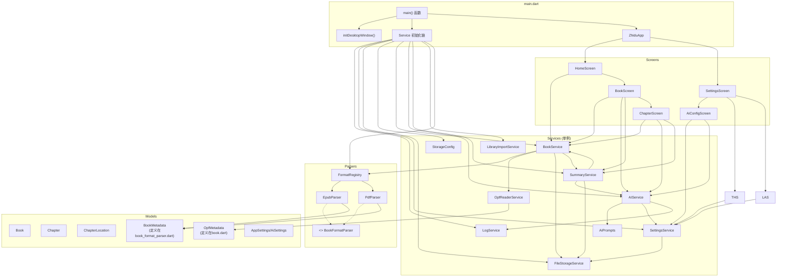
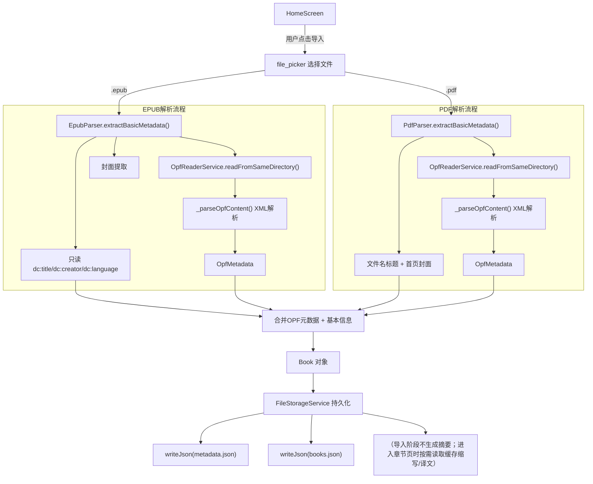
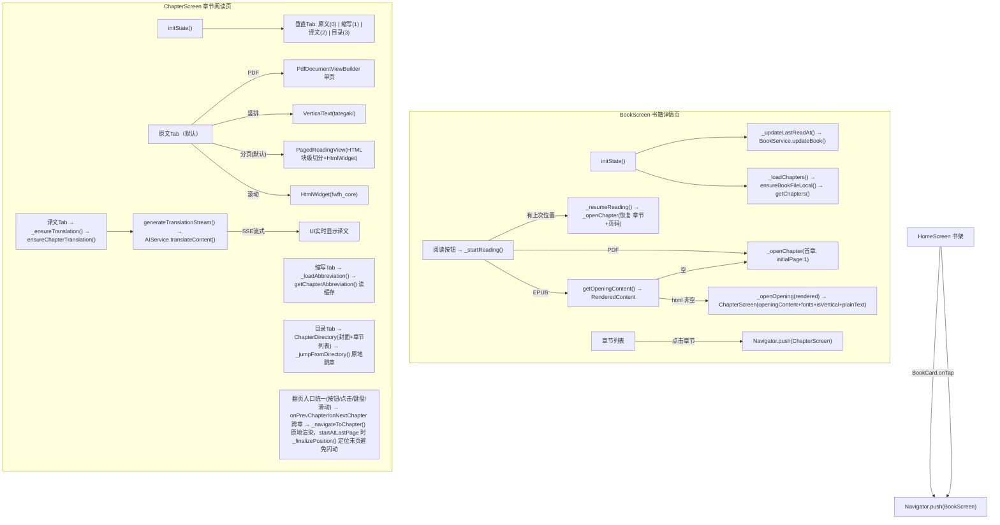
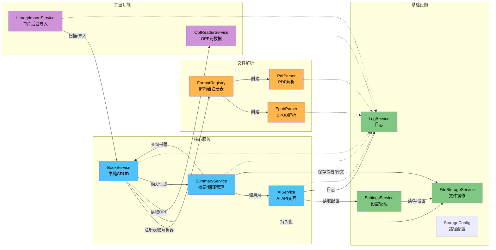
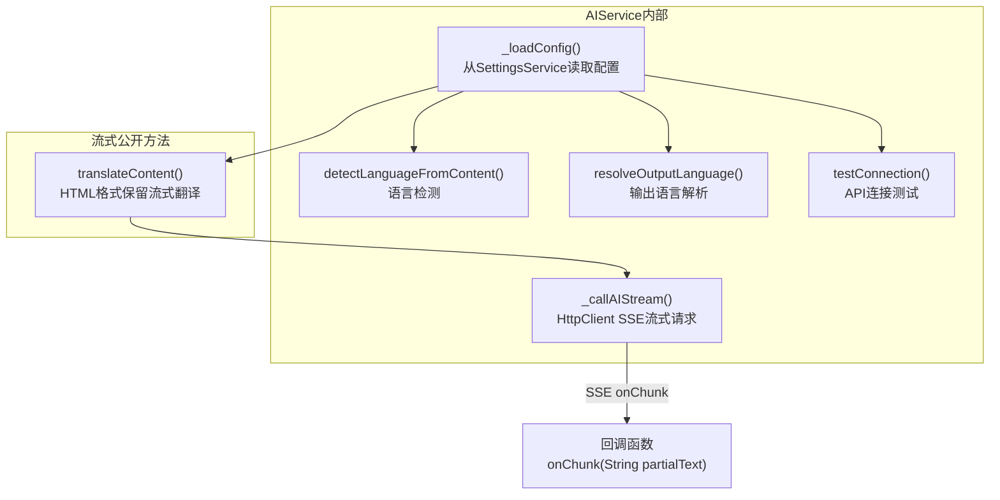
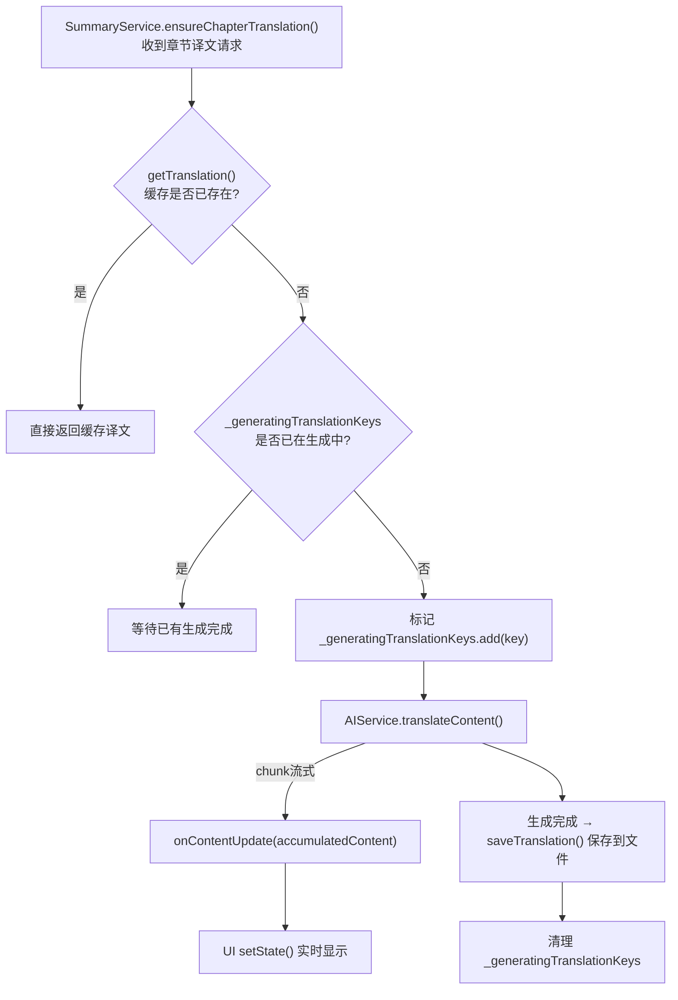
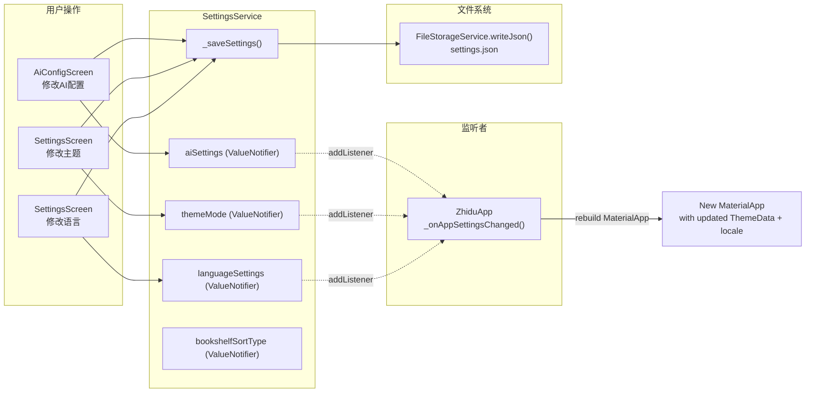
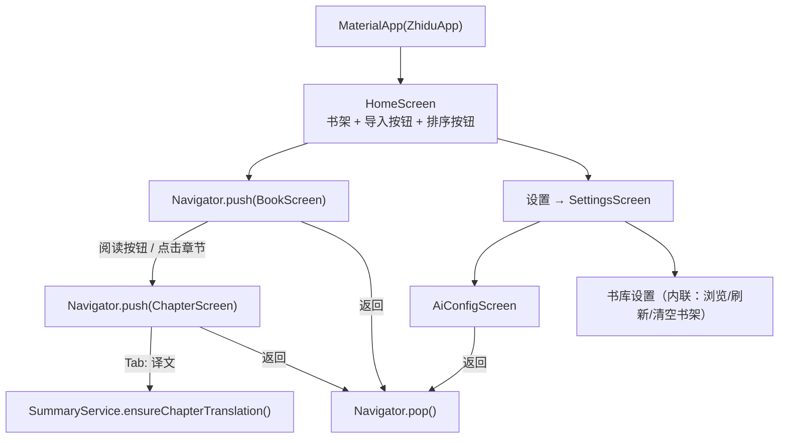
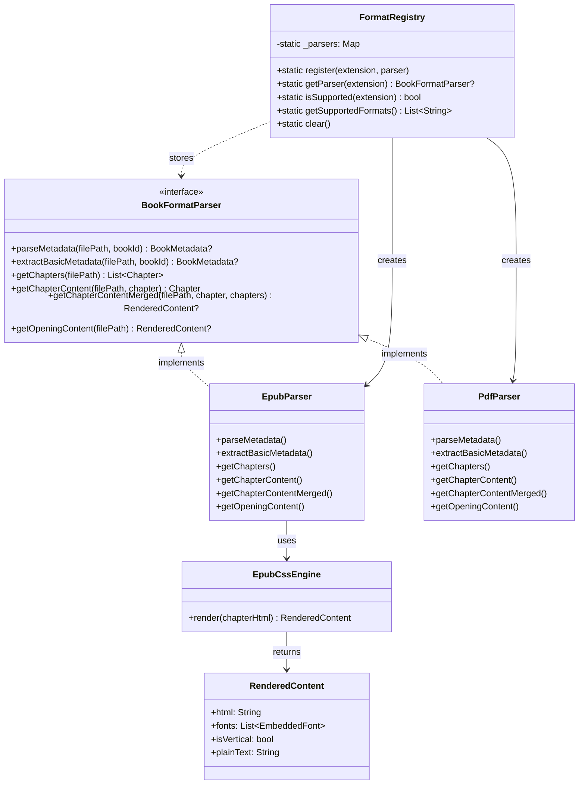
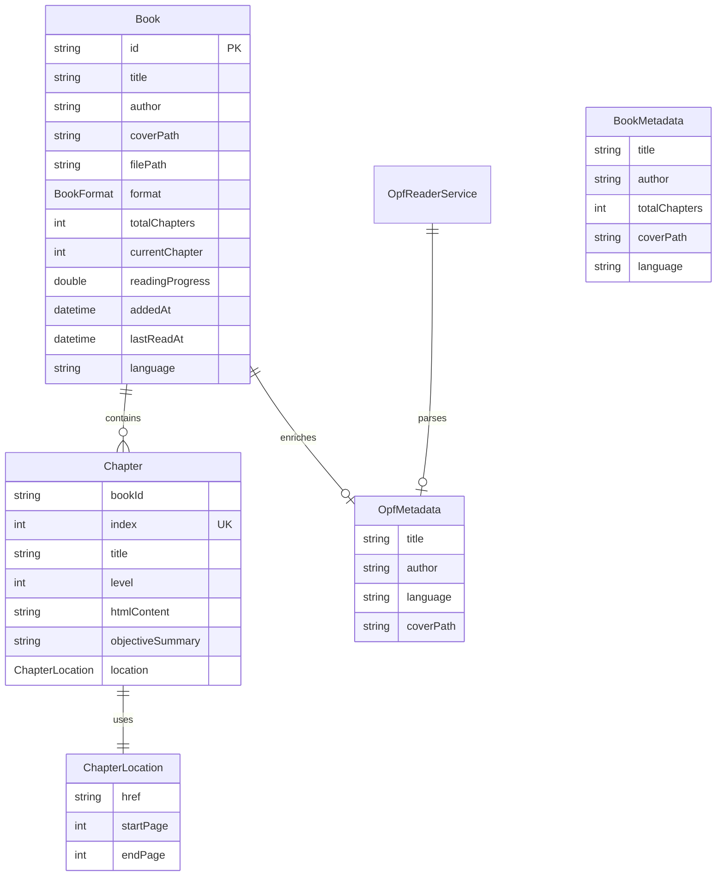

# 智读 (Zhidu) 可视化类/函数调用关系图 (Mermaid)

> **文档版本**: v2.18 | **更新日期**: 2026-11-26

---

## 一、全局架构总图



---

## 二、书籍导入流程（详细）



---

## 三、阅读流程



---

## 四、Service 核心交互关系图



---

## 五、数据库/文件持久化 UML

```mermaid
erDiagram
  SettingsService ||--|| FileStorageService : "读/写 settings.json"
  BookService ||--|| FileStorageService : "读/写 books.json + metadata.json"
  SummaryService ||--|| FileStorageService : "写 Summary-XXX-zh.md"
  SummaryService ||--|| FileStorageService : "写 chapter-XXX-en.html"

  FileStorageService ||--|| StorageConfig : "使用路径约定"

  settings_json {
    string ai_provider
    string api_key
    string model
    string base_url
    string theme_mode
    string ui_language
    string output_language
  }

  books_json {
    array Book list
  }

  Book {
    string id PK
    string title
    string author
    string filePath
    string coverPath
    string format epub_or_pdf
    int totalChapters
    int currentChapter
    double readingProgress
    datetime addedAt
    datetime lastReadAt
    string language
  }

  chapter_nnn_zh_md {
    string summary_markdown
  }

  chapter_nnn_en_html {
    string translation_html
  }
```

---

## 六、AIService 内部调用链



---

## 七、译文防重复机制



---

## 八、设置响应式更新流程（ValueNotifier）



---

## 九、UI 导航层级结构



---

## 十、格式解析器架构（策略+注册表）



---

## 十一、数据模型关系图



---

## 更新记录

| 日期 | 更新内容 |
|------|----------|
| 2026-11-26 | 修复续读定位失效 — `_finalizePosition()` 延迟读 `widget.initialPageIndex` 时该值已被父级重置为 0；改为 `_pendingPageIndex` 在 initState/didUpdateWidget 固化目标页，定位后清空；新增回归测试 |
| 2026-11-26 | 修复页码保存为 0 — `TabBarView` 销毁远离子页导致 `PagedReadingView` 重建、页码归零并覆盖父级 `_pagedCurrentPage`；加 `AutomaticKeepAliveClientMixin` 保活 + `initialPageIndex: _initialPagedPage ?? _pagedCurrentPage` + 翻章重置页码 |
| 2026-11-26 | 修复续读位置不准 — `_startReading()` 先 `getBookById()` 刷新 `_book`（否则再次点「阅读」读不到新进度，退回全书首页）；首章进度经 `_openOpening(initialPagedPage:)` 恢复；翻页后 2s 防抖保存 + 已保存位置去重 |
| 2026-11-26 | 书架续读（入口调整）— `Book` 新增 `lastChapterIndex`/`lastPageIndex`；`ChapterScreen._saveReadingPosition()` 在翻章/退出时保存位置；书架点击仍进书籍详情，详情页「阅读」`_startReading()` 有记录时 `_resumeReading()` 续读，否则开全书首页；`PagedReadingView.initialPageIndex` 恢复页码 |
| 2026-11-26 | 阅读页新增「目录」Tab — `ChapterScreen` 垂直 Tab 扩为 4 个（原文/缩写/译文/目录）；新增 `lib/widgets/chapter_directory.dart`（`BookCover` + `buildChapterTiles` + `ChapterDirectory`），书籍详情页与阅读页复用同一套封面/章节列表；点击原地跳章，子章节定位标题所在页，同章内用 `positionToken` 触发重定位 |
| 2026-11-26 | 章节列表全层级可点击 — `BookScreen` 取消仅 L0 可点，子章节经 `_topLevelChapterOf()` 定位顶层章节 + `initialAnchor` 定位标题所在页（`PagedReadingView._pageForAnchor()`） |
| 2026-11-26 | 修复合并章节丢失正文 — `ChapterScreen` 新增 `_allChapters`（完整章节列表），`_loadChapterContent()` 用它调用 `getChapterContentMerged()`；此前误传仅 `level==0` 的 `_chapters`，导致子章节所在文件的正文整段丢失 |
| 2026-11-21 | 分页阅读翻页导航完善 — 修复跨章闪动（`_pageViewHidden` + `_finalizePosition()` 分页稳定后定位目标页）；翻页入口统一（`PagedReadingView` 新增 `onPrevChapter`/`onNextChapter`，点击/键盘到边界跨章）；滑动跨章（`BouncingScrollPhysics` + overscroll 监听，`_crossChapterTriggered` 防重复） |
| 2026-11-20 | EPUB 显示能力改进 — 渲染器替换 `flutter_html` → `flutter_widget_from_html_core`（`HtmlWidget`）；CSS 内联重写为 `EpubCssEngine`（csslib + cascadia + 特异性级联）；`@font-face` 字体嵌入（SHA-1 反混淆 + `FontLoader`）；图片内联（background-image/SVG）；竖排 `VerticalText`（tategaki）；分页阅读 `PagedReadingView`（TextPainter 切页，默认模式）；`getChapterContentMerged`/`getOpeningContent` 返回值改为 `RenderedContent`，新增 `RenderedContent`/`EmbeddedFont` 模型 |
| 2026-11-19 | 阅读/章节页重构 — 删除 AI 缩写预处理与全书摘要；`BookFormatParser` 新增 `getOpeningContent()`（阅读按钮直达第一页）；`ChapterScreen` 删除「生成缩写」按钮、缩写改为 `_loadAbbreviation` 仅读缓存；章节 Tab 重排为 原文/缩写/译文；翻章改为原地渲染 `_navigateToChapter()`（保留旧内容后台加载无闪动）；翻页按钮样式调整 |
| 2026-11-18 | 打开书籍自动本地化文件 — `BookService.ensureBookFileLocal()` 判断 `filePath` 是否在应用目录，非本地复制到 `books/{bookId}/book{ext}` 并更新持久化；`BookScreen._loadChapters()` 解析前调用 |
| 2026-11-17 | 书架排序功能 — 新增 `BookSortType` 枚举（7 种排序）；`SettingsService` 新增 `bookshelfSortType` ValueNotifier + `setBookshelfSortType()`；HomeScreen 新增排序按钮，`_sortedBooks()` 按排序方式排序并持久化 |
| 2026-11-17 | 阅读进度追踪：`BookScreen.initState` 新增 `_updateLastReadAt()`（打开书籍更新最后阅读时间并持久化）；`_loadChapters` 成功后保存 `totalChapters`；HomeScreen 书架按 `lastReadAt` 降序排序（新增 `_sortedBooks()`） |
| 2026-11-17 | AI/界面语言设置合并为统一「语言」设置 — `LanguageSettings` 精简为 `languageMode`+`language`（删「跟随书籍」，仅「跟随系统/用户自选」）；`resolveOutputLanguage`/`needsTranslation` 简化、删除 `_detectLanguageFromMetadataAndContentWithBookId`；设置页语言 UI 合并为一组；清理 18 个 l10n 僵尸 key |
| 2026-11-17 | 首页书架 UI 优化 — 移除底部状态栏（书籍总数移至 AppBar 标题）；搜索范围含书名+作者；卡片比例 3:4.5；封面 `fitWidth + topCenter` 兼容竖/横封面；书名/作者叠加封面底部半透明条；封面右上角格式徽章；书架键盘滚动（↑/↓/PgUp/PgDn） |
| 2026-11-16 | Calibre 书库导入 + 首页书架优化 — 服务层新增 `LibraryImportService`（后台导入、断点续传、refreshSignal）；导入改为 `extractBasicMetadata`（只读书名/作者/封面，不解析章节）；`BookFormatParser`/`EpubParser`/`PdfParser` 新增 `extractBasicMetadata()`；导入阶段不再直接生成摘要；SettingsScreen 新增书库设置；OPF 封面改从 `<guide>` 读 |
| 2026-11-13 | 冗余代码清理同步 — 删除 `EpubService`/`PdfService`/`TranslationService`（已合并/删除），统一为 `EpubParser`/`PdfParser`/`SummaryService`；`_initWindowManager()` → `initDesktopWindow()`；`_onThemeChanged()`/`_onLocaleChanged()` → `_onAppSettingsChanged()`；删除 `_generateBookSummaryFromPreface()` 分支（统一章节摘要→全书摘要）；`translateHtmlStream()` → `translateContent()`；`TranslationService.translateEpubContent()` → `SummaryService.generateTranslationStream()`；解析器接口新增 `parseMetadata()`、删除 `extractCover()`；OpfMetadata 精简为 4 字段、新增 BookMetadata 实体；章节摘要文件名 `chapter-XXX-zh.md` → `Summary-XXX-zh.md` |
| 2026-05-11 | 完整 Mermaid 可视化：全局架构图、导入/阅读/翻译流程图、Service交互图、并发控制图、ValueNotifier数据流图、导航图、解析器架构图、数据模型ER图 |
